# Thomas Virdis · CTCycle

Senior data scientist and ML engineer at Inmatica. I build open-source tools for clinical and scientific work, mostly local first.

[LinkedIn](https://www.linkedin.com/in/thomas-virdis/) · [Medium](https://medium.com/@ctcycle)

## About

My route here went through the lab: a bachelor's and a master's in biotechnology at the University of Genoa, then a PhD in engineering sciences at the Vrije Universiteit Brussel on CheckPack, micro-sensors for real-time food-spoilage monitoring. Most of what I build now comes out of that experience. Scientific data is messy, and a tool that hides how it reached a number is hard to trust.

Most of the applications below share a shape: a local Python service with an Angular or React interface, and a model that either ships with the app or points at an endpoint you already have.

## Projects

### Clinical and scientific

**[DILIGENT Clinical Copilot](https://github.com/CTCycle/DILIGENT-Clinical-Copilot)** `Python` `FastAPI` `Angular`
Decision support for Drug-Induced Liver Injury review, running on one machine. You enter a case, run an assessment with a local or hosted model, then check the draft against the structured findings, medication timeline and drug-match flags before anyone acts on it.

**[XREPORT Radiological Reports](https://github.com/CTCycle/XREPORT-radiological-reports-generator)** `PyTorch` `Transformers` `FastAPI` `Angular`
Generates editable draft radiological reports from X-ray images, and covers the loop around that: dataset preparation, local training and evaluation, side-by-side comparison of several report generators. A research tool, not a diagnostic device.

**[EMADB Autopilot](https://github.com/CTCycle/EMADB-Autopilot)** `Python` `ChromeDriver`
Collects adverse drug reaction reports from the EMA's EudraVigilance database by driving the search interface and saving the exports. No longer maintained.

**[ADSMOD Adsorption Modeling](https://github.com/CTCycle/ADSMOD-Adsorption-Modeling)** `Python` `PyTorch` `React`
Adsorption workbench. Fits theoretical isotherm models to experimental data, enriches the material records with PubChem properties, then trains predictors on the NIST and ARPA-E isotherm collections.

### Model and LLM tooling

**[LLMeter](https://github.com/CTCycle/LLMeter-local-benchmarks)** `Rust`
Single binary CLI for measuring local OpenAI-compatible providers: repeatable benchmark runs, performance scenarios, and Markdown or HTML reports you can hand to someone else.

**[TKBEN](https://github.com/CTCycle/TKBEN-tokenizers-benchmarker)** `Python` `FastAPI` `Angular`
Compares tokenizers on your own text. Vocabulary, throughput, and whether encode/decode actually preserves the input, with the dashboard exportable as a PDF.

**[ParaGraph](https://github.com/CTCycle/ParaGraph-LLM-workflow)** `Python` `FastAPI` `React Flow`
Visual workspace for LLM workflows. Wire the steps together as nodes, run the graph, and watch each stage as it executes, which is easier to reason about than a chain of prompts buried in a script.

**[AEGIS Geospatial View](https://github.com/CTCycle/AEGIS-Geospatial-View)** `Python` `FastAPI` `Angular`
Geospatial workspace that starts from a question instead of a form. Ask for a place, a set of coordinates or a mapping task, and it assembles the view from the public data sources it has access to.

### Experiments

**[FAIRS Roulette Player](https://github.com/CTCycle/FAIRS-Roulette-Player)** `PyTorch` `FastAPI` `React`
Workspace for reinforcement-learning experiments on roulette. Import or generate data, train a DQN agent, save checkpoints, then step through inference sessions and compare each suggestion with what the wheel actually did.

**[FeXT AutoEncoder](https://github.com/CTCycle/FEXT-Autoencoder)** `PyTorch` `PySide6`
Desktop pipeline for training convolutional autoencoders over image datasets and exporting the latent vectors, built on a VGG16-style encoder. No longer maintained.

## Toolbox

Python and Rust for most of the work, TypeScript for the interfaces. PyTorch, Hugging Face Transformers and scikit-learn for the models; FastAPI, SQLAlchemy, SQLite or PostgreSQL, Docker and GitHub Actions around them. On the science side: RDKit, NumPy, pandas, and public databases such as NIST, ARPA-E and PubChem.

## Stats

