  
  
  

# Thomas Virdis · CTCycle

Senior data scientist and ML engineer at Inmatica. Most of my week is clinical and biological data: neural signals, sleep monitoring funded by the Italian space agency, and text buried in hospital documents. The repositories here are that work at a smaller scale. Usually a question about the data, and a tool that would answer it faster by hand.

## About

I came to this through a lab. BSc in biotechnology in Genoa, then an MSc in advanced biotechnology and a PhD in engineering sciences at the VUB in Brussels, where I worked on CheckPack: machine learning over electrochemical sensor arrays to catch food spoilage while it happens.

Sensor work makes you suspicious in a useful way. A channel drifts, and the label everybody trained on was one person's judgement at one moment. I still build like that, so a tool here usually shows the intermediate steps and lets you argue with them before you accept a number.

Most of the applications are a Python service you run yourself, with an Angular or React client in front and a model that either ships with the app or points at an endpoint you already pay for.

## Projects

### Clinical and scientific

**[DILIGENT Clinical Copilot](https://github.com/CTCycle/DILIGENT-Clinical-Copilot)** `Python` `FastAPI` `Angular`
Decision support for Drug-Induced Liver Injury review, running on one machine. Enter a case, ask a local or hosted model for an assessment, then check the draft against the structured findings, the medication timeline and the drug-match flags. That review is where the time goes.

**[XREPORT Radiological Reports](https://github.com/CTCycle/XREPORT-radiological-reports-generator)** `PyTorch` `Transformers` `FastAPI` `Angular`
Draft radiological reports from X-ray images, plus the parts that make a model usable in research: dataset preparation, local training, evaluation, and several generators compared on the same image. Research code, not a diagnostic device.

**[ADSMOD Adsorption Modeling](https://github.com/CTCycle/ADSMOD-Adsorption-Modeling)** `Python` `PyTorch` `Angular`
Fits theoretical isotherm models to experimental adsorption data, pulls the material properties in from PubChem, then trains predictors on the NIST and ARPA-E collections. Fitted parameters and model predictions stay in the same view.

**[EMADB Autopilot](https://github.com/CTCycle/EMADB-Autopilot)** `Python` `ChromeDriver`
Drives the EudraVigilance search interface and saves the exports, because the query I needed was not on offer as an API. No longer maintained.

### Model and LLM tooling

**[LLMeter](https://github.com/CTCycle/LLMeter-local-benchmarks)** `Rust`
One binary for benchmarking local OpenAI-compatible providers: repeated runs, fixed scenarios, and Markdown or HTML reports you can hand to a colleague who was not in the room.

**[TKBEN](https://github.com/CTCycle/TKBEN-tokenizers-benchmarker)** `Python` `FastAPI` `Angular`
Compares tokenizers on your own text instead of a sample corpus: vocabulary, throughput, and whether encoding then decoding gives the input back. The dashboard exports to PDF when the comparison has to leave the app.

**[Neuro Weave Studio](https://github.com/CTCycle/Neuro-Weave-Studio)** `Python` `FastAPI` `Angular`
Local editor for machine-learning model graphs. Assemble nodes, connect typed ports, and get graph and tensor-shape diagnostics before a single weight moves. The Keras source it generates is meant to be read by a person afterwards.

**[ParaGraph](https://github.com/CTCycle/ParaGraph-LLM-workflow)** `Python` `FastAPI` `React Flow`
Graph editor for LLM workflows in the ComfyUI tradition: wire the steps as nodes, run the graph, watch each stage as it executes. When a step comes back empty you can see which node did it and what it received.

### Geospatial and reference

**[AEGIS Geospatial View](https://github.com/CTCycle/AEGIS-Geospatial-View)** `Python` `FastAPI` `Angular`
Geospatial workspace where the question comes first. Ask for a place, a set of coordinates or a mapping task, and it assembles the view from the public sources it can reach, more than a thousand of them.

**[api-atlas](https://github.com/CTCycle/api-atlas)** `Markdown` `Python`
Directory of APIs, datasets, open-data portals and MCP servers, around 2,500 entries across 45 categories. Each row names its source and the date it was last checked. There are no accounts and nothing crawls the web. The catalog is Markdown, with a machine-readable copy for scripts.

### Experiments

**[FAIRS Roulette Player](https://github.com/CTCycle/FAIRS-Roulette-Player)** `PyTorch` `FastAPI` `React`
DQN agent on roulette, with the unglamorous parts included: data import, training runs, checkpoints, then inference sessions where every suggestion is scored against what the wheel actually did. A place to learn reinforcement learning against a random opponent.

**[FeXT AutoEncoder](https://github.com/CTCycle/FEXT-Autoencoder)** `PyTorch` `PySide6`
Convolutional autoencoders over image folders, with a desktop interface for training and exporting latent vectors. VGG16-style encoder, written while I was learning PyTorch. Unmaintained.

## Toolbox

Python for most of it, Rust when a single binary is the right shape, TypeScript in the front ends. PyTorch and scikit-learn for models, FastAPI and SQLAlchemy underneath, SQLite until a project earns PostgreSQL, Docker and GitHub Actions on the ones that ship. On the chemistry side RDKit, NumPy and pandas, plus whatever public database the current question needs.

## Stats

